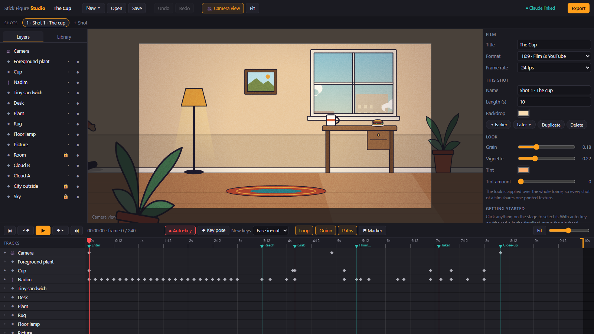

# Stick Figure Studio

A 2D animation studio in the browser. The stick figure is the hidden rig; the audience sees the artwork.
Open `index.html`. No build step, no server, no dependencies, works offline.

And you can direct it in plain language: an MCP server lets Claude Code build and animate scenes in the app for you.



**Project → Shots → Objects and characters → Animation tracks**

## Run

```bash
git clone https://github.com/mariobilly/stick-figure-studio.git
```

Open `stick-figure-studio/index.html` in Chrome or Edge. Your work autosaves in the browser (IndexedDB);
**Ctrl+S** saves a project file.

## Workflow

1. **Library tab**: add characters, props, a background (Room, Beirut street, Beirut beach), your own images, text, sounds.
2. **Pose**: select a character and drag the red joints. Wrists and ankles use IK (the whole limb follows);
   hold **Alt** to rotate a single bone. The orange joint moves the body. **📌 Pin foot** keeps a planted foot from sliding.
3. **Animate**: with **● Auto-key** on, move the playhead and change anything. Only the property you touched gets a key.
   Expand a row in the timeline to see its tracks; drag keys to retime, select keys to edit their easing curve.
4. **Direct**: select **Camera** and move/zoom it. Press **C** for Director view to see the whole set with the camera as a teal frame.
   Layers with different **Depth** give parallax.
5. **Attach** a prop to a hand (Inspector → Layer → Attach to) at the playhead; detach it later to drop or throw it.
6. **Export**: MP4 / WebM with sound, or a frame-accurate PNG sequence + WAV for Premiere / DaVinci.

## Directing with Claude (MCP)

`mcp/server.js` links the app to [Claude Code](https://docs.claude.com/en/docs/claude-code), the same way the
Blender MCP works. You say what you want in a Claude Code chat ("a tired taxi driver walks up to a falafel cart
at sunset, orders, and the camera pushes in when he tastes it") and Claude builds it in the app: characters,
props (it can draw new ones), sets, animation, camera and sound. It renders frames to check its own work, and
everything it makes stays editable by hand.

Setup (Node.js 18 or newer, no `npm install` needed):

```bash
claude mcp add stick-figure-studio --scope user -- node "/path/to/stick-figure-studio/mcp/server.js"
```

- Open a **new** Claude Code session to get the tools. Claude can open the studio for you (Edge or Chrome on
  Windows), or open `index.html` yourself; the toolbar shows **● Claude linked**.
- Tools: `open_studio`, `studio_status`, `get_api`, `get_scene`, `run_code`, `get_frame`, `playback`,
  `render_video`, `save_project`, `load_project`, `import_files`.
- `render_video` needs [ffmpeg](https://ffmpeg.org) on your PATH and saves MP4s to `~/Videos/Stick Figure Studio`.
- `mcp/API.md` is the reference Claude reads each session. `js/custom.js` is where reusable props, clips and
  characters that Claude makes for you are kept.
- One request from Claude = one Ctrl+Z in the app.
- The app and the MCP server talk over `127.0.0.1` only, with a random token the server creates on first run (`mcp/.token`).

## What's in the library

- **Characters**: built-in presets plus a character studio (hair, beard, glasses, brows, head shape, sleeves,
  colours, proportions). Every character has a keyable **View**: `side` (three-quarter) or `front` (facing the camera),
  with the same rig and keys. Front-view wardrobe: `tie` and `apron`.
- **Props**: furniture, food, plants, street lamps, cars in five colours, a Beirut "service" taxi, a van, the plastic
  parking chair, beach umbrella, towel, sandcastle, a flag in two states (no wind / windy), kite, kite tail, kite spool.
- **Backgrounds**: Room with a view, Beirut street, Beirut beach (hazy skyline, the Pigeon Rocks, rolling swell). All with parallax.
- **Builders** (in `js/custom.js`, used by Claude through the MCP): a dog rig that trots and wags (mutt or Cavalier),
  scrolling rain, rising flood water, colour washes for storm light and lightning, a kite with a swishing tail,
  a seagull that flaps.
- **Sounds** (synthesised, no files): footsteps, clinks, whooshes, car horn, dog bark, thunder, rain, splash,
  seagull, waves, wind, phone ring, alarm, crowd cheer and boo, and more. A **lip-sync assistant** keys mouths from
  any recording.
- **Layer clipping**: `obj.clipTo = { id, rect }` shows a layer only inside a rectangle of another layer (a caller inside a phone screen).
- **Demo film**: "The Cup", a 10-second short built through the same API as the editor.

## Shortcuts

| Key | Action | Key | Action |
|---|---|---|---|
| Space | Play / pause | K | Key the whole pose |
| ← → (Shift = 10) | Step frames | M | Marker at playhead |
| , . | Previous / next key | A | Auto-key on/off |
| C | Camera ↔ Director view | O | Onion skin |
| F | Fit stage | [ ] | Layer back / forward |
| Ctrl+C / V | Copy / paste keys | Delete | Delete keys, else the selection |
| Ctrl+D | Duplicate | Ctrl+Z / Y | Undo / redo |
| Ctrl+S | Save project file | Ctrl+E | Export |

Stage: wheel zooms, middle/right-drag pans, double-click empty space to fit. Timeline: Ctrl+wheel zooms, Shift+wheel scrolls.

## Code map (`js/`, plain scripts on `window.Studio`; loaded in this order)

| File | Role |
|---|---|
| `core.js` | namespace, state, utilities, easing (cubic-bezier), refresh scheduling |
| `model.js` | project/shot/object factories, tracks & keys, evaluation, camera layers, attach/detach |
| `rig.js` | skeleton, FK, two-bone IK, foot pins |
| `draw-character.js` | body parts, faces, expressions, mouths, hands, imported part artwork |
| `draw-front.js` | the front view of every character |
| `render.js` | the one renderer used by the stage, thumbnails and every export; grain/vignette/tint |
| `library.js` | props, backgrounds, character presets, motion clips (walk cycle, wave, take…) |
| `custom.js` | reusable props, sets and builders added on top of the library |
| `audio.js` | tracks, waveforms, built-in synthesised sounds, WAV, lip-sync assistant |
| `store.js` | image assets, undo, IndexedDB autosave, project files, character library |
| `demo.js` | "The Cup": the 10-second demo film, built through the same API as the editor |
| `actions.js` | directing by code: walk, pick up, put down, throw, drink, look, say, camera moves, set building |
| `stage.js` | selection, gizmos, posing, camera frame, onion skins, motion paths |
| `timeline.js` | rows, keys, audio clips, markers, transport |
| `panels.js` | shots bar, layers, library, inspector (character studio, easing editor) |
| `export.js` | MP4/WebM capture, PNG sequence (folder or zip), WAV, stills |
| `bridge.js` | the app side of the Claude link (polls the MCP server on 127.0.0.1) |
| `main.js` | playback, toolbar, shortcuts, boot |

## License

[MIT](LICENSE)
